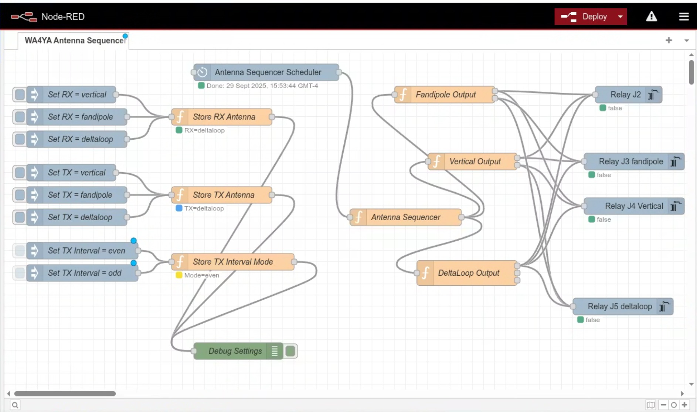

wa4ya antenna sequencer
===============

### About
Node-Red Keyestudios Relay Shield KS0212 based antenna sequencer switch @WA4YA. Relay shield is hooked up to 4-way antenna switch. The sequencer is driven by WSJT-X transmit/receive status messages: when WSJT-X starts transmitting it selects the TX antenna, and when it returns to receive it selects the RX antenna.

Manual TX and RX antennas can be selected with the `Set TX = ...` and `Set RX = ...` buttons. `switch antenna immediately` re-applies the current antenna selection. When `follow bands` is enabled the antenna is selected from the reported WSJT-X frequency instead, and it is updated automatically whenever WSJT-X reports a new frequency.

Antenna switching occurs on the WSJT-X transmit/receive status event, so use appropriate relay/PTT interlocking to avoid hot switching.

Based on [WA4YA Antennas](https://github.com/chrbayer84/wa4ya-antennas), so naming as per that sketch and the antennas available in the shack (vertcal, delta loop and fan dipole). Delta Loop is the default and unpowered fallback (there is no unconnected antennas at this point although that would be nice to have) so wiring for the delta loop is different from the other ports.

If you want to the same antenna for TX and RX just set it for both parameters and there will be no switching at all.

Manual selection of 4 antennas possible using node red. One antenna is wired such that it becomes active when there is no power so logic is inverted for that antenna (the deltaloop antenna in this sketch). When an antenna is selected, all other antennas are disabled/disengaged. 

